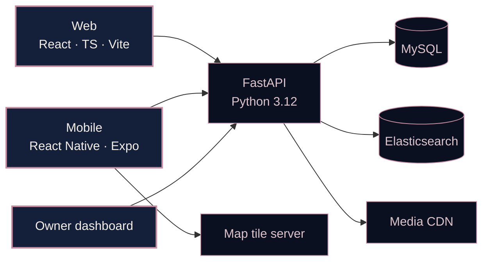

<!-- Repo: mounasmiri/mounasmiri (public, same name as your username) -->

**I turn ideas into things that work.**

[**Portfolio**](https://YOUR-PORTFOLIO-URL) &nbsp;·&nbsp; [**LinkedIn**](https://linkedin.com/in/YOUR-HANDLE) &nbsp;·&nbsp; [**Email**](mailto:YOUR-EMAIL)

 

  
### Choose your path

| [Projects](#selected-projects) | [Toolkit](#toolkit) | [Activity](#activity) | [Beyond code](#beyond-the-terminal) | [Hire me](#lets-build-something) |
|:-:|:-:|:-:|:-:|:-:|

---

## Hi, I'm Mouna

I'm a third-year Software Engineering student at **ISI Ariana (Class of 2027)**, interested in the space where **software engineering, product thinking, and entrepreneurship** meet.

I like understanding what happens beneath the interface: how applications are structured, how data moves, how search behaves, and how technical decisions shape the experience of the person using it.

> *I build to learn, experiment to understand, and refine until the product makes sense.*

<table>
<tr>
<td width="50%" valign="top">

**Currently focused on**
- Full-stack and mobile development
- Backend architecture, databases, and search
- Product engineering and user-centred problem solving

</td>
<td width="50%" valign="top">

**Next step**
- 4–6 month **PFE internship**, starting **Jan/Feb 2027**
- Real software products, strong engineers to learn from
- Full-stack / product engineering roles

</td>
</tr>
</table>

---

## Selected projects

Quality over repository count. These are the projects that best represent how I build.

### HangriTok &nbsp;·&nbsp; *Co-founder · Frontend & Dashboard Lead*

**Discover places through food videos and restaurant search.**

A full-stack food discovery platform combining short-form videos, restaurant search, a web app, a mobile app, and restaurant-owner tools.

**My part:** leading frontend work across web and mobile, building the restaurant-owner dashboard and onboarding flow, and working with the team on Elasticsearch indexing and search so product requirements connect cleanly to the backend.

<b>Full architecture & infrastructure</b>

 

| Layer | Technologies |
|---|---|
| Backend API | Python 3.12 · FastAPI |
| Web | React · TypeScript · Vite |
| Mobile | React Native · Expo |
| Database | MySQL |
| Search | Elasticsearch |
| Local environment | Docker Compose |
| Infrastructure | Kubernetes configurations |
| Supporting services | Media CDN · Map tile server |

`Status: working demo · in development` &nbsp;→&nbsp; [**Explore the repository**](https://github.com/SmiriAziz/HangriTok)

---

### Khzenty

**A digital wardrobe built around real clothes and everyday decisions.**

Organise your actual garments, build outfits, track what you've worn recently, and plan packing, so getting dressed becomes a decision you've already made.

- Full-stack app with a layered backend: **Route → Controller → Service**
- Garment management, outfit creation, *Recently Worn* tracking, context-based organisation
- Packing workflows and reusable frontend components

`React 19` `TypeScript` `Vite` `Tailwind CSS v4` `shadcn/ui` `Express 5` `Prisma 7` `PostgreSQL` `Zod`

`Status: final refinements` &nbsp;→&nbsp; [**Explore the repository**](https://github.com/mounasmiri?tab=repositories)

---

### More explorations

<table>
<tr>
<td width="50%" valign="top">

#### Life OS
A self-hosted personal dashboard for habits, workouts, meals, sleep, and routines, with no accounts, cloud dependency, or subscriptions.

`Dashboard design` `Self-hosting` `Productivity`

[Repository →](https://github.com/mounasmiri?tab=repositories)

</td>
<td width="50%" valign="top">

#### Moon Portfolio Tracker
Turns GitHub contribution activity into a personal progress dashboard, with streaks and an installable iPhone PWA.

`GitHub OAuth` `API integration` `PWA`

[Repository →](https://github.com/mounasmiri?tab=repositories)

</td>
</tr>
<tr>
<td width="50%" valign="top">

#### CoreDB
A C++ exploration of how databases work underneath: data storage, management, and the concepts behind them.

`C++` `Systems programming` `Database fundamentals`

[Repository →](https://github.com/mounasmiri?tab=repositories)

</td>
<td width="50%" valign="top">

#### MonnWear
An early web development project in PHP, built on XAMPP.

`PHP` `XAMPP`

[Repository →](https://github.com/mounasmiri/monnwear)

</td>
</tr>
</table>

---

## Toolkit

 

| | |
|---|---|
| **Frontend** | React · React Native (Expo) · TypeScript · Vite · Tailwind CSS · shadcn/ui |
| **Backend** | Node.js · Express · Python · FastAPI · REST APIs |
| **Data & search** | PostgreSQL · MySQL · Prisma · Elasticsearch |
| **Infrastructure** | Docker · Docker Compose · Git · GitHub · Kubernetes configurations |
| **Languages** | TypeScript · JavaScript · Python  · PHP · HTML · CSS |

---

## Beyond the terminal

### BYLINK &nbsp;·&nbsp; *Founder*

A digital invitation business I built on my own, from the first service idea to the ordering platform and customer delivery.

| | |
|---|---|
| **Platform** | Built an online **ordering platform and admin panel** |
| **Product** | Developed **custom invitation websites** in HTML and CSS |
| **Traction** | Served **20+ clients** in the first few months |
| **Reach** | One TikTok video passed **100K views** |

Currently paused while I focus on my engineering studies and PFE preparation.

### Leadership & community

| Experience | Contribution |
|---|---|
| **SecuriNets-ISI** · 2025–2026 | Media Manager · Junior Manager |
| **Securicon** · 2026 | Organizer |
| **Securicon** · 2025 | On-stage Moderator |
| **Enactus-ISI** | Developed a plastic-brick housing concept and helped lead a project team |

---

## Let's build something

I'm looking for a **4–6 month PFE internship starting January/February 2027**, ideally on a real software product where I can contribute to full-stack work, learn from experienced engineers, and grow in product engineering.

*Curiosity starts the idea. Engineering brings it to life.*

